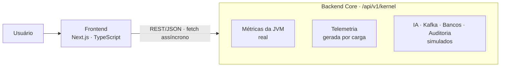

# ⚙️ TechnoSystems Lab — Backend Core


Backend em **Spring Boot (Java 21)** do **TechnoSystems Lab**, um laboratório interativo de arquitetura de sistemas disponível em [technosystems.com.br](https://technosystems.com.br).

O frontend (Next.js/TypeScript) consome esta API REST e exibe painéis que demonstram, de forma interativa, o comportamento de arquiteturas de alta performance: **memória da JVM, orquestração de LLMs, persistência híbrida SQL/NoSQL, mensageria com Kafka, telemetria e auditoria**.

> ### ⚠️ Leia antes: o que é real e o que é simulado
> Este projeto é um **laboratório de estudo e portfólio**. Apenas parte dos endpoints executa lógica real; o restante **simula** o comportamento de componentes como Spring AI, Kafka e bancos de dados, para demonstrar o contrato de API e a experiência de uso. A tabela de endpoints abaixo indica o que é cada um, e o [roadmap](#-roadmap) mostra como cada simulação será substituída por uma integração real.

---

## 🧱 Arquitetura



- **Contrato de API ponta a ponta:** o frontend e o backend conversam por REST/JSON, com respostas assíncronas (`fetch`/AJAX) e atualização de estado em tempo real na interface.
- **Um controller por domínio do laboratório:** cada painel do site corresponde a um endpoint (ver abaixo).

## 🔌 Endpoints

Base path: `/api/v1/kernel`

| Painel | Método e rota | O que faz | Natureza |
|---|---|---|---|
| Métricas do sistema | `GET /metrics` | Lê RAM usada, alocada e máxima da JVM e o número de núcleos via `Runtime` | ✅ **Real** |
| Telemetria dinâmica | `GET /telemetry?load=<0-100>` | Gera uma onda de pontos para o gráfico, calculada a partir do nível de carga e de ruído aleatório | 🔄 **Gerado** (cálculo real, dados sintéticos) |
| IA (Spring AI) | `POST /ai/chat` | Recebe um `prompt` e devolve uma resposta estruturada de exemplo | 🧪 **Simulado** (dados fictícios) |
| Banco de dados | `GET /database/query?type=postgres\|mongo` | Devolve latência e resultado de exemplo para cada tipo de banco | 🧪 **Simulado** |
| Mensageria (Kafka) | `POST /kafka/publish` | Devolve partição e offset sorteados | 🧪 **Simulado** |
| Auditoria | `POST /audit/scan` | Devolve um log de auditoria de exemplo | 🧪 **Simulado** |
| Teste de carga | `POST /stress` | Devolve o resultado de um teste de carga de exemplo | 🧪 **Simulado** |

### Exemplos

```bash
# Métricas reais da JVM
curl http://localhost:8080/api/v1/kernel/metrics

# Telemetria com carga de 70%
curl "http://localhost:8080/api/v1/kernel/telemetry?load=70"

# IA (resposta simulada)
curl -X POST http://localhost:8080/api/v1/kernel/ai/chat \
  -H "Content-Type: application/json" \
  -d '{"prompt":"Faturamento do trimestre"}'

# Consulta a banco (simulada)
curl "http://localhost:8080/api/v1/kernel/database/query?type=postgres"

# Publicação no Kafka (simulada)
curl -X POST http://localhost:8080/api/v1/kernel/kafka/publish \
  -H "Content-Type: application/json" \
  -d '{"topic":"demo","message":"hello"}'
```

Exemplo de resposta de `GET /metrics`:

```json
{
  "usedRam": 142,
  "allocatedRam": 256,
  "maxRam": 4096,
  "coresActive": 8,
  "status": "OPERATIONAL_NATIVE"
}
```

> Os valores variam conforme a máquina.

## 🚀 Como rodar

**Requisitos:** Java 21 e Maven (ou o wrapper `mvnw` do projeto).

```bash
git clone https://github.com/Efra85/technosystems-backend.git
cd technosystems-backend

./mvnw spring-boot:run
```

A API sobe em `http://localhost:8080`. Teste com:

```bash
curl http://localhost:8080/api/v1/kernel/metrics
```

## 🧰 Stack

| Camada | Tecnologias |
|---|---|
| **Backend** | Java 21 · Spring Boot · Spring Web (REST) |
| **Frontend** | Next.js · TypeScript |
| **Integração** | REST/JSON · `fetch`/AJAX assíncrono |

## 🗺️ Roadmap

Substituição dos módulos simulados por integrações reais:

- [ ] **IA:** orquestração de LLMs com Spring AI (Ollama / OpenAI)
- [ ] **Mensageria:** Apache Kafka com `KafkaTemplate` (produtor e consumidor, DLQ e idempotência)
- [ ] **Persistência:** PostgreSQL e MongoDB reais, com pool de conexões
- [ ] **Performance:** build nativo com GraalVM AOT e comparativo de tempo de inicialização e memória
- [ ] **Qualidade:** testes de integração (Testcontainers) e CI com GitHub Actions
- [ ] **Segurança:** restringir CORS aos domínios do laboratório e adicionar rate limiting
- [ ] **Observabilidade:** Micrometer + Prometheus + Grafana

## 🎯 Objetivo do projeto

Mostrar, de forma prática e visual, como componentes de uma arquitetura moderna se comportam e se comunicam, além de documentar o caminho de evolução de cada módulo, de simulação para implementação real.

## 👤 Autor

**Efraim Corrêa Ortiz** — Desenvolvedor Full Stack
[LinkedIn](https://www.linkedin.com/in/efraimcorreaortiz) · [technosystems.com.br](https://technosystems.com.br) · efraimortiz@outlook.com

## 📄 Licença

Distribuído sob a licença MIT. Veja o arquivo `LICENSE`.
